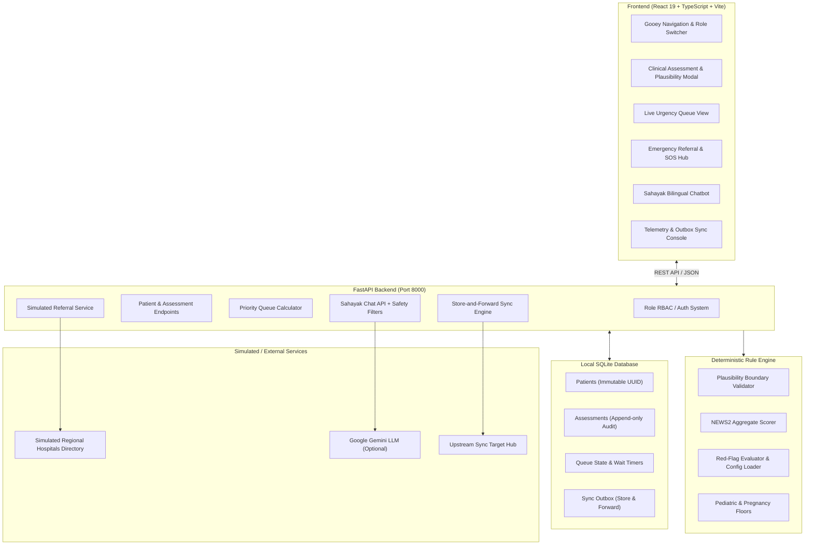

# UpcharAI — AI Triage Assistant for Rural Health Centres

> **CT BuildFest 2.0 · Problem Code: CTBF-AI-02 · AI & Intelligent Systems**  
> *An explainable, offline-first clinical decision-support prototype designed to help rural health workers prioritise patients, identify red-flag conditions, and coordinate emergency referrals.*

[](https://www.python.org/)
[](https://fastapi.tiangolo.com/)
[](https://react.dev/)
[](https://www.typescriptlang.org/)
[](https://tailwindcss.com/)
[](https://www.rcplondon.ac.uk/)
[](tests/)
[](#offline-first-architecture--outbox-sync)

---

## Table of Contents

- [The Problem](#the-problem)
- [The UpcharAI Solution](#the-upcharai-solution)
- [System Architecture](#system-architecture)
- [Key Features](#key-features)
  - [1. Deterministic Triage Engine & NEWS2 Scoring](#1-deterministic-triage-engine--news2-scoring)
  - [2. Clinical Red-Flag Rules & Escalation Floors](#2-clinical-red-flag-rules--escalation-floors)
  - [3. Physiological Plausibility Checks](#3-physiological-plausibility-checks)
  - [4. Explainable Findings & Suggested Actions](#4-explainable-findings--suggested-actions)
  - [5. Dynamic Live Urgency Queue](#5-dynamic-live-urgency-queue)
  - [6. Role-Based Governance & Clinician Finalisation](#6-role-based-governance--clinician-finalisation)
  - [7. Emergency Referral & Simulated SOS Coordination](#7-emergency-referral--simulated-sos-coordination)
  - [8. Offline-First Architecture & Outbox Sync](#8-offline-first-architecture--outbox-sync)
  - [9. Sahayak Multilingual Health Chatbot](#9-sahayak-multilingual-health-chatbot)
- [Repository Structure](#repository-structure)
- [Technology Stack](#technology-stack)
- [Quick Start Guide](#quick-start-guide)
  - [Prerequisites](#prerequisites)
  - [Backend Setup](#backend-setup)
  - [Frontend Setup](#frontend-setup)
  - [Alternative: Standalone Server](#alternative-standalone-server)
- [Demo Accounts & Roles](#demo-accounts--roles)
- [Canonical Demo Scenarios](#canonical-demo-scenarios)
- [REST API Reference](#rest-api-reference)
- [Testing & Quality Assurance](#testing--quality-assurance)
- [Safety Notice & Claim Boundaries](#safety-notice--claim-boundaries)

---

## The Problem

Primary Health Centres (PHCs), Sub-Centres, and Community Health Centres (CHCs) in rural regions face systemic bottlenecks:
- **Severe Clinician Shortages:** Frontline triage is commonly staffed by Accredited Social Health Activists (ASHAs), Auxiliary Nurse Midwives (ANMs), or junior nursing staff with limited specialist diagnostic support.
- **Intermittent or Absent Connectivity:** Unreliable internet access prevents dependency on pure cloud services.
- **Delayed Recognition of Acute Deterioration:** Subtle vital sign deterioration can go unrecognised during morning peak surges without standardized scoring.
- **Referral Delays:** Critical emergency cases require timely transfer summaries and regional facility routing without administrative friction.

---

## The UpcharAI Solution

**UpcharAI** provides a transparent, local-first clinical triage assistant designed for single-operator field speed (intake completion in $\le 90$ seconds).

```
   [ Patient Arrival ]
           │
           ▼
 [ Rapid Intake Form ] ──────► [ Physiological Plausibility Checks ]
           │
           ▼
 [ Deterministic Engine ] ────► NEWS2 Score + Red-Flag Matrix + Escalation Floors
           │
           ▼
  [ 3-Tier Priority ] ────────► EMERGENCY / URGENT / ROUTINE + Plain-Language Reasons
           │
           ▼
  [ Live Urgency Queue ] ─────► Real-Time Prioritisation by Severity & Wait Duration
           │
           ▼
[ Clinician Finalisation ] ───► Doctor Reviews, Confirms, or Overrides with Reason
           │
           ▼
[ Referral / Outbox Sync ] ──► Simulated Hospital SOS + Store-and-Forward Outbox
```

1. **Deterministic, Side-Effect-Free Triage:** Combines the Royal College of Physicians **NEWS2** physiological scoring system with clinical red-flag logic and pediatric/obstetric escalation floors.
2. **Transparent Explanations:** Explains why a case received its priority by detailing individual component scores and fired rule conditions.
3. **Local-First & Offline Resilience:** All patient records, triage assessments, and queue states persist in local SQLite. When internet connection returns, an asynchronous outbox synchronizes data to higher-tier facilities.
4. **Assistive Decision-Support Guardrails:** All results remain `PRELIMINARY` until a qualified medical clinician reviews and finalises the triage decision.

---

## System Architecture



---

## Key Features

### 1. Deterministic Triage Engine & NEWS2 Scoring
The engine (`engine/news2.py`, `engine/rules.py`, `engine/triage.py`) computes standardized National Early Warning Scores across adult physiological vitals:
- **Respiration Rate (RR)**
- **Oxygen Saturation ($SpO_2$) Scale 1 & Scale 2**
- **Supplemental Oxygen Indicator**
- **Systolic Blood Pressure (SBP)**
- **Pulse Rate**
- **Level of Consciousness (AVPU / Alertness)**
- **Body Temperature (°C)**

Aggregated score thresholds:
- Total score $\ge 7$: Triggers `EMERGENCY` priority via rule `NW-E01`.
- Total score $5 - 6$: Triggers `URGENT` priority via rule `NW-U01`.
- Any single vital score of $3$: Triggers `URGENT` priority via rule `NW-U02`.

### 2. Clinical Red-Flag Rules & Escalation Floors
Configured in `rules/rules.v1.yaml` and loaded version-controlled at runtime:
- **Critical Hypoxia / Hypotension (`RF-E01`):** $SpO_2 \le 90\%$ or $\text{SBP} \le 90\text{ mmHg} \implies$ `EMERGENCY`.
- **Severe Respiratory Distress (`RF-E02`):** Severe breathing difficulty reported $\implies$ `EMERGENCY`.
- **Depressed Consciousness (`RF-E03`):** Patient responsive only to Pain or Unresponsive (`AVPU = P / U`) $\implies$ `EMERGENCY`.
- **Ongoing Seizures (`RF-E04`):** Active seizure presentation $\implies$ `EMERGENCY`.
- **Severe Hemorrhage (`RF-E05`):** Uncontrolled bleeding $\implies$ `EMERGENCY`.
- **Stroke Signs (`RF-E06`):** Sudden facial droop, unilateral arm weakness, slurred speech $\implies$ `EMERGENCY`.
- **Toxicology / Envenomation (`RF-E07`):** Suspected venomous snakebite or acute poisoning $\implies$ `EMERGENCY`.
- **Obstetric Emergencies (`RF-E08`):** Heavy vaginal bleeding or convulsions in pregnancy $\implies$ `EMERGENCY`.
- **Cardiovascular Red-Flag (`RF-E09`):** Chest pain paired with abnormal physiological markers ($SpO_2$, SBP, or Pulse scoring $\ge 2$) $\implies$ `EMERGENCY`.
- **Pediatric Safety Floor (`FLOOR-01`):** Age $< 16$ enforces minimum `URGENT` priority because adult NEWS2 scoring is physiologically inappropriate for children.
- **Maternal Safety Floor (`FLOOR-02`):** Active pregnancy enforces minimum `URGENT` priority for clinician review.

### 3. Physiological Plausibility Checks
Before evaluating triage rules, `engine/plausibility.py` validates vital signs against clinical limits:
- Core temperature: $30.0^\circ\text{C} - 45.0^\circ\text{C}$
- Systolic BP: $40 - 300\text{ mmHg}$
- Diastolic BP: $20 - 200\text{ mmHg}$ (requires $\text{SBP} > \text{DBP}$)
- Oxygen saturation: $50\% - 100\%$
- Heart rate: $20 - 250\text{ bpm}$
- Respiration rate: $4 - 70\text{ breaths/min}$

Implausible values reject silent acceptance (`HTTP 422`). Frontline staff must explicitly confirm the value before triage proceeds.

### 4. Explainable Findings & Suggested Actions
Every generated assessment returns human-readable findings and suggested actions:
- **Emergency:** *"Alert the doctor now."*
- **Urgent:** *"Doctor should see this patient soon, before routine cases."*
- **Routine:** *"No urgent signs found by this tool. A clinician still reviews every case."*

Assessments missing optional parameters (such as RR or AVPU) are explicitly tagged with `UNDERSTATED` or `INCOMPLETE` flags.

### 5. Dynamic Live Urgency Queue
The patient queue (`/api/queue`) organizes waiting patients using a multi-factor sort:
1. **Effective Priority Rank:** `EMERGENCY` (Rank 1) $>$ `URGENT` (Rank 2) $>$ `ROUTINE` (Rank 3).
2. **Clinical Urgency Escalations:** Frontline staff upward adjustments take immediate precedence.
3. **Arrival Time & Elapsed Wait Time:** Fair FIFO ordering within equal priority tiers.
4. **Stale Data Watchdog:** Detects connectivity loss or background polling failures older than 6 seconds.

### 6. Role-Based Governance & Clinician Finalisation
The system enforces clinical role boundaries:
- **Triage Nurse / Health Worker (`NURSE`):** Enters patient vitals, registers symptoms, views queue, triggers upward clinical escalations with written justification. Cannot downgrade or finalise cases.
- **Clinician / Medical Officer (`DOCTOR`):** Reviews findings, examines audit history, and finalises the triage decision. Has permission to adjust priority up or down with mandatory clinical notes.
- **Citizen / Patient (`user`):** Access restricted exclusively to the informational Sahayak Chatbot.

### 7. Emergency Referral & Simulated SOS Coordination
For acute emergency cases (`EMERGENCY` priority):
- Prepares a referral transfer slip with patient display code, timestamp, vitals, primary symptoms, and triggered rule findings.
- Simulates regional hospital routing using `hospitals/hospitals.json` (Community Health Centres, Sub-District Hospitals, Civil Hospitals, and Tertiary wings) with distance, ICU readiness, oxygen status, and emergency dispatch contact numbers (`+91 108`).
- **Simulated Notice:** Explicitly labelled as a simulation — *no real ambulance is dispatched and no real hospital is notified*.

### 8. Offline-First Architecture & Outbox Sync
Designed for austere rural deployments:
- **Local SQLite Persistence:** Works with the internet disconnected. All registrations, vitals, reassessments, and notes write immediately to local disk.
- **Store-and-Forward Outbox (`sync_outbox`):** Transactionally queues patient transfers and audit records in an outbox.
- **Idempotent Synchronization:** Once network connectivity is established, outbox records push to the configured central hub (`SYNC_TARGET_URL`) with deduplication.

### 9. Sahayak Multilingual Health Chatbot
Provides public health education in English, Hindi (Devanagari), and transliterated Hindi (Hinglish):
- **Deterministic Emergency Pre-Filter:** Intercepts emergency keywords (*"chest pain"*, *"सीने में दर्द"*, *"saas lene me taklif"*, *"heavy bleeding"*, *"snakebite"*, *"behoshi"*) **before** contacting the LLM. Instantly returns a high-priority advisory to seek emergency medical attention.
- **Clinical Boundaries:** Rejects dosage calculation requests and prescription queries. Does not diagnose.

---

## Repository Structure

```
UpcharAI/
├── api/                             # FastAPI application & REST routing
│   ├── routes/                      # Route modules
│   │   ├── assessments.py           # Intake, evaluation, escalation & finalisation
│   │   ├── auth.py                  # User authentication & role profiles
│   │   ├── chat.py                  # Sahayak chatbot with emergency keyword pre-filter
│   │   ├── demo.py                  # Demo state reset & seed endpoint
│   │   ├── hospitals.py             # Regional hospital directory lookup
│   │   ├── patients.py              # Patient registration & detail retrieval
│   │   ├── queue.py                 # Live priority queue computation
│   │   ├── referrals.py             # Emergency referral summary generation
│   │   └── sync.py                  # Store-and-forward outbox synchronization
│   ├── auth.py                      # PBKDF2 password hashing & token issuance
│   ├── config.py                    # Environment variables & database path configuration
│   ├── db.py                        # SQLite schema initialization & database helpers
│   ├── errors.py                    # Standardized API error handler
│   ├── main.py                      # FastAPI root application & CORS middleware
│   ├── models.py                    # Pydantic schemas & response models
│   └── roles.py                     # Role definitions & permission verification
│
├── engine/                          # Pure deterministic triage & scoring engine
│   ├── config.py                    # Rule configuration loader & validator
│   ├── models.py                    # Dataclasses (AssessmentInputs, Finding, TriageResult)
│   ├── news2.py                     # Royal College of Physicians NEWS2 algorithm
│   ├── plausibility.py              # Physiological boundary checks
│   ├── rules.py                     # Red-flag triggers, combinations & safety floors
│   └── triage.py                    # Pure evaluate_triage() orchestration
│
├── frontend/                        # Modern React single-page application
│   ├── src/
│   │   ├── assets/                  # Application graphics & SVG icons
│   │   ├── components/              # React view components
│   │   │   ├── AssessmentModal.tsx  # Intake form, vital entry, plausibility confirmation
│   │   │   ├── EmergencyReferralView.tsx # SOS referral summary & hospital lookup
│   │   │   ├── Header.tsx           # Status bar, network indicator, role badge
│   │   │   ├── Footer.tsx           # Mandatory disclaimers & version watermark
│   │   │   ├── GooeyNav.tsx         # Animated accessible navigation bar
│   │   │   ├── LoginPage.tsx        # Simulated user login & role selection modal
│   │   │   ├── OverviewView.tsx     # Metrics dashboard & quick-action triggers
│   │   │   ├── SahayakChatView.tsx  # Bilingual chatbot interface
│   │   │   ├── TelemetrySyncView.tsx # Outbox sync management & demo reset console
│   │   │   └── TriageQueueView.tsx  # Live priority queue & clinician action pane
│   │   ├── context/AppContext.tsx   # Global state management & toast notifications
│   │   ├── api.ts                   # TypeScript HTTP client
│   │   ├── types.ts                 # Type definitions
│   │   └── App.tsx                  # Root component
│   ├── package.json                 # Node dependencies & Vite build scripts
│   └── vite.config.ts               # Vite bundler & reverse proxy configuration
│
├── hospitals/
│   └── hospitals.json               # Simulated regional referral facilities directory
│
├── rules/
│   ├── rules.v1.yaml                # Canonical rule definitions, triggers & weights
│   └── rules.v1.json                # JSON compiled mirror for portability
│
├── seed/
│   ├── scenarios.json               # 4 canonical demo scenarios
│   ├── scenarios.py                 # Python fixtures for demo scenarios
│   ├── seed_data.py                 # Scenario database loader
│   └── seed_db.py                   # CLI database reset and seed utility
│
├── tests/                           # Comprehensive test suite (47 tests)
│   ├── oracle.yaml                  # 12 canonical clinical oracle test cases
│   ├── test_api.py                  # API endpoints, status codes & validation tests
│   ├── test_auth.py                 # Role boundaries & credential authentication tests
│   ├── test_claim_strings.py        # Static scan for forbidden marketing/clinical claims
│   ├── test_engine.py               # NEWS2 calculation & rule evaluator tests
│   ├── test_oracle.py               # Oracle verification against oracle.yaml
│   ├── test_security_and_strings.py # Privacy leaks, API key protection & string scans
│   └── test_sync.py                 # Outbox persistence & target mode ingest tests
│
├── files/                           # System design specifications & canonical registry
│   ├── 00-registry.md               # Requirement IDs & decision records
│   ├── 01-product-and-acceptance.md # User journeys, acceptance criteria, UI truth table
│   ├── 02-triage-rule-spec.md       # Clinical scoring specifications & rule details
│   ├── 03-architecture-data-api.md  # SQLite schema, API contracts & sync architecture
│   └── 04-verification-delivery.md  # Verification matrix, risks & claim definitions
│
├── server.py                        # Standalone Python HTTP/REST server
├── requirements.txt                 # Python backend package dependencies
└── README.md                        # Project documentation
```

---

## Technology Stack

| Layer | Technologies | Purpose |
|---|---|---|
| **Backend Framework** | Python 3.12+, FastAPI, Uvicorn | High-performance asynchronous REST API |
| **Data Validation** | Pydantic v2 | Strict schema validation for inputs and outputs |
| **Triage & Rules** | Python, PyYAML | Pure, side-effect-free deterministic rule engine |
| **Local Persistence** | SQLite3 | Local-first relational database with WAL journal mode |
| **Frontend Framework** | React 19, TypeScript | Reactive, type-safe single-page interface |
| **Frontend Tooling** | Vite, Tailwind CSS v4, Oxlint | Fast HMR development and responsive styling |
| **Iconography** | Lucide React | Clear accessible UI icons |
| **Chatbot & NLP** | Google Gemini API + Deterministic Pre-Filters | Multilingual health education with safety intercepts |
| **Testing Suite** | Pytest, Pytest-Cov, Starlette TestClient | Automated functional, oracle, and security regression testing |

---

## Quick Start Guide

### Prerequisites
- **Python:** Version 3.12 or newer
- **Node.js:** Version 18 or newer (with `npm`)

---

### Backend Setup

1. **Clone the repository:**
   ```bash
   git clone https://github.com/your-org/UpcharAI.git
   cd UpcharAI
   ```

2. **Create and activate a virtual environment:**
   ```bash
   # Windows (PowerShell)
   python -m venv .venv
   .venv\Scripts\Activate.ps1

   # Linux / macOS
   python3 -m venv .venv
   source .venv/bin/activate
   ```

3. **Install dependencies:**
   ```bash
   pip install -r requirements.txt
   ```

4. **Initialize and seed the database:**
   ```bash
   python seed/seed_db.py --reset
   ```

5. **Start the FastAPI server:**
   ```bash
   uvicorn api.main:app --host 127.0.0.1 --port 8000 --reload
   ```
   *The interactive Swagger API documentation will be available at [http://127.0.0.1:8000/docs](http://127.0.0.1:8000/docs).*

---

### Frontend Setup

1. **Navigate to the frontend directory:**
   ```bash
   cd frontend
   ```

2. **Install frontend dependencies:**
   ```bash
   npm install
   ```

3. **Launch the development server:**
   ```bash
   npm run dev
   ```
   *The web application will open at [http://localhost:5173/](http://localhost:5173/). Vite is configured to automatically proxy `/api` requests to `http://127.0.0.1:8000`.*

---

### Alternative: Standalone Server
UpcharAI also includes a lightweight zero-dependency server launcher in `server.py`:
```bash
python server.py 8000
```
This runs an HTTP server hosting the local API and database endpoints at `http://localhost:8000/`.

---

## Demo Accounts & Roles

The system includes pre-seeded demonstrator credentials for testing different role permissions:

| Role Type | Username | Password | Assigned Persona | Permitted Views & Actions |
|---|---|---|---|---|
| **Clinician** | `doctor` | `doctor123` | Dr. Ananya Sharma | Full access: Overview, Triage Queue, Assessment, Upward/Downward Finalisation, Emergency SOS, Telemetry. |
| **Triage Nurse** | `staff` | `staff123` | Pooja Devi | Full access: Overview, Triage Queue, Assessment, Upward Priority Escalation, Emergency SOS, Telemetry. Cannot lower or finalise priorities. |
| **Citizen / Patient** | `patient` | `user123` | Rahul Verma | Restricted access: Sahayak Multilingual Health Information Chatbot only. |
| **Citizen / Patient** | `user` | `user123` | Sita Devi | Restricted access: Sahayak Multilingual Health Information Chatbot only. |

---

## Canonical Demo Scenarios

UpcharAI includes 4 pre-loaded scenarios representing real-world rural triage dilemmas:

1. **Scenario 1 (P-101) — Severe Respiratory Distress (`EMERGENCY`):**  
   58-year-old male with severe breathing difficulty, $SpO_2\text{ 86\%}$, and pulse $120\text{ bpm}$. Triggers rule `RF-E01` (Critical Hypoxia) and `RF-E02` (Severe Breathing Difficulty). Immediate referral candidate.
2. **Scenario 2 (P-102) — Acute Chest Pain with Vital Abnormalities (`EMERGENCY`):**  
   52-year-old male presenting with chest pain, borderline $SpO_2\text{ 92\%}$, and pulse $100\text{ bpm}$. Triggers combination rule `RF-E09` (Chest Pain + Abnormal Vitals).
3. **Scenario 3 (P-103) — Pediatric Fever Presentation (`URGENT`):**  
   8-year-old female presenting with fever. Even with stable adult vital ranges, triggers pediatric escalation floor `FLOOR-01` (Age $< 16$) to ensure mandatory clinician evaluation.
4. **Scenario 4 (P-104) — Maternal Antenatal Assessment (`URGENT`):**  
   24-year-old pregnant patient presenting for routine check-up. Triggers pregnancy safety floor `FLOOR-02`, preventing automated classification as routine without clinician review.

*To restore these scenarios at any time during a live demonstration, click **Reset & Seed Demo Scenarios** in the Telemetry tab, or send a `POST /api/demo/reset` request.*

---

## REST API Reference

### Health & System Status
- `GET /api/health` — Verifies system status, operational mode, and disclaimers.

### Authentication & Roles
- `POST /api/auth/login` — Authenticates credentials, returns bearer token and role configuration.
- `GET /api/auth/me` — Retrieves authenticated user profile and permissions.
- `GET /api/auth/roles` — Returns role descriptions and permission definitions.

### Patients & Assessments
- `POST /api/patients` — Registers a new patient and creates an initial clinical assessment.
- `GET /api/patients/{id}` — Fetches complete patient history and previous assessments.
- `POST /api/assessments/preview` — Deterministically previews NEWS2 score, rules, flags, and priority without database writes.
- `POST /api/assessments/{id}/escalate` — Nurses/Clinicians can escalate a priority upward with justification.
- `POST /api/assessments/{id}/finalise` — Doctors can confirm, upgrade, or downgrade a priority with mandatory clinical rationale.

### Priority Queue
- `GET /api/queue` — Returns live priority-sorted list of patients, wait durations, and flags.

### Regional Hospitals & Emergency Referrals
- `GET /api/hospitals` — Returns list of simulated regional referral facilities.
- `POST /api/referrals` — Generates a simulated referral package for transfer coordination.

### Offline Telemetry & Outbox Sync
- `GET /api/sync/status` — Returns outbox telemetry (pending, sent, failed counts).
- `POST /api/sync/push` — Manually flushes pending outbox records to the upstream sync destination.
- `POST /api/sync/ingest` — Ingestion endpoint used when operating in target mode (`TARGET_MODE=1`).

### Sahayak Health Chatbot
- `POST /api/chat` — Multilingual educational chatbot endpoint with deterministic emergency pre-filtering.

### Demo Utilities
- `POST /api/demo/reset` — Truncates tables and re-seeds canonical demonstration scenarios.

---

## Testing & Quality Assurance

The codebase includes an automated regression test suite covering unit, API, oracle, and security constraints:

```bash
# Execute the full pytest test suite
python -m pytest -v
```

### Test Coverage Highlights (47 Passed)
- **`test_api.py` (10 tests):** Verifies endpoints, payload validations, error codes (`400`, `404`, `422`), role permissions, and queue sorting.
- **`test_auth.py` (12 tests):** Validates password hashing, token expiration, role capabilities, and access control boundaries.
- **`test_engine.py` (6 tests):** Validates NEWS2 scores against Royal College of Physicians tables, plausibility checks, and rule trigger logic.
- **`test_oracle.py` (12 tests):** Validates the 12 canonical clinical scenarios defined in `tests/oracle.yaml` against expected priorities and fired rule sets.
- **`test_security_and_strings.py` (4 tests):** Enforces data privacy (ensuring no patient identifiers leak in logs or errors), verifies no hardcoded API keys exist, and checks for claim compliance.
- **`test_sync.py` (2 tests):** Tests outbox store-and-forward reliability and target-mode security.
- **`test_claim_strings.py` (1 test):** Scans the application for forbidden over-claiming phrases.

---

## Safety Notice & Claim Boundaries

> [!IMPORTANT]
> **Clinical Decision Support Notice**  
> UpcharAI is a prototype developed for CT BuildFest 2.0 (Category: AI & Intelligent Systems).  
> - **Not Clinically Validated:** This prototype is not clinically validated and does not replace medical professionals.
> - **Non-Diagnostic:** This tool does not diagnose, treat, or prescribe medication. All priorities generated by the system are preliminary triage suggestions.
> - **Routine Does Not Mean Safe:** A "Routine" priority simply indicates that no urgent physiological signs were detected by the configured rules; it does not mean the patient is safe or free from illness. A qualified clinician must evaluate every case.
> - **Simulated Referrals:** Emergency SOS workflows and hospital directories are simulated for demonstration purposes. **No real ambulance is dispatched and no real hospital is notified.**
> - **Synthetic Patient Data:** All patient records and scenarios provided in this repository are synthetic and fictional. No Protected Health Information (PHI) is included or processed.
